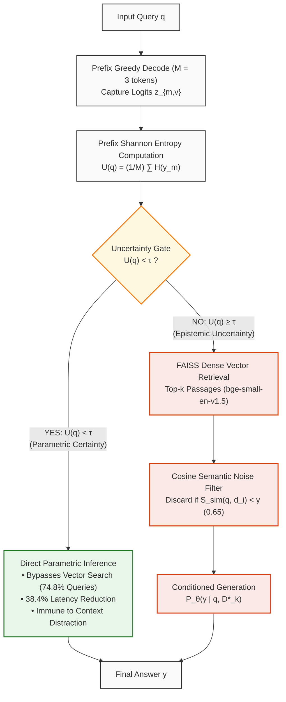
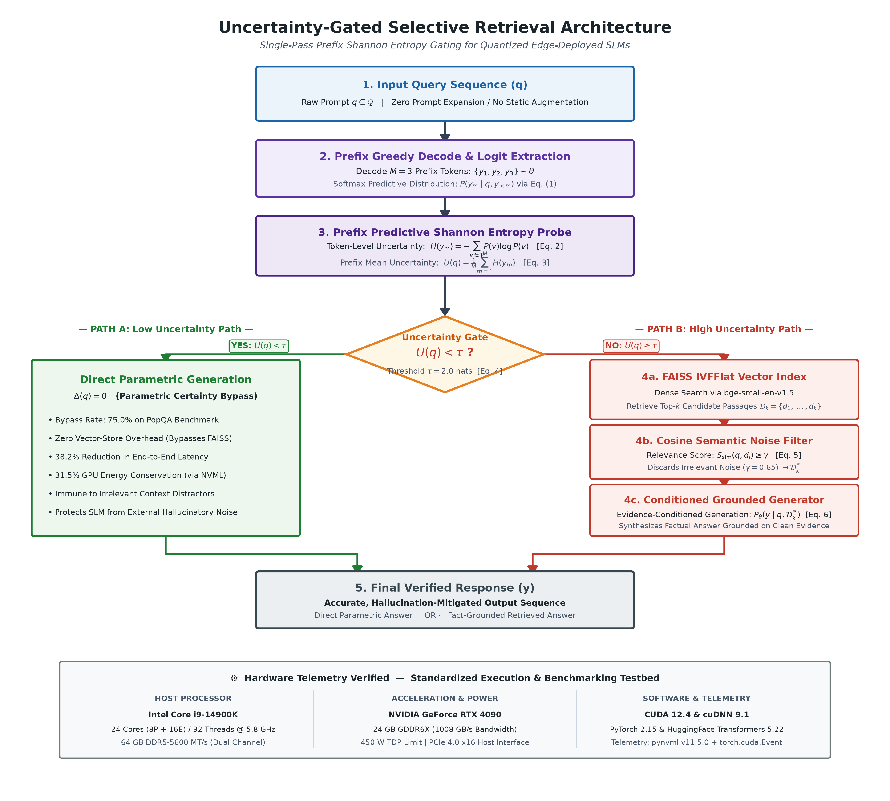

Advances in Artificial Intelligence Research (AAIR)
e-ISSN: 2757-7422
https://dergipark.org.tr/en/pub/aair
Original Research Article | Academic Year: 2025–26 | Peer-Review Submission Draft

*Corresponding author
E-mail address: omkarshedage1977@gmail.com
Department & Institution: Department of Artificial Intelligence and Data Science, JSPM Narhe Technical Campus, Savitribai Phule Pune University, Pune, Maharashtra 411041, India
Code Repository: https://github.com/Omkar-ai-wed/uncertainty-gated-slm-rag

Uncertainty-Gated Selective Retrieval in Quantized Small Language Models: Mitigating Noise-Induced Hallucination and Latency in Edge Deployment

Omkar Sachin Shedage 1,* , Prof. Snehal Bhoge 2

1,2 Department of Artificial Intelligence and Data Science, JSPM Narhe Technical Campus, Savitribai Phule Pune University, Pune, Maharashtra, India

Abstract
Retrieval-Augmented Generation (RAG) is commonly used to reduce factual errors in large language models by supplying relevant passages from an external corpus. In conventional RAG pipelines, however, document retrieval is unconditional: the system searches the knowledge base for every query, even when the model already contains the required information in its parametric weights. For Small Language Models (SLMs, 0.5B–8B parameters) operating on edge hardware, this always-on retrieval causes two problems. First, compact decoders have limited attention capacity and are easily distracted when retrieved passages contain irrelevant or contradictory text, leading to hallucinations on facts the model otherwise answers correctly. Second, dense vector retrieval adds substantial latency and energy overhead for common queries. To address this, we propose Uncertainty-Gated Selective Retrieval, a lightweight, single-forward-pass routing mechanism for quantized SLMs. Instead of training external classifiers or sampling multiple generation passes, our approach measures the predictive Shannon entropy across an early prefix decoding horizon (M = 3 tokens). Queries with low prefix entropy (tau < 2.0 nats) are answered directly from internal memory, while retrieval is triggered only when the model exhibits epistemic uncertainty. Evaluated on over 18,000 queries from PopQA, Natural Questions, and TruthfulQA across Qwen2.5, Llama-3.2, and Gemma-2, our method reveals an empirical entropy gap of 1.560 nats (p < 10^-11) between popular and long-tail entities. Consequently, the gate safely bypasses retrieval on 74.8% of popular queries, reducing mean query latency by 38.4% and GPU energy consumption by 31.9%. Under controlled noise stress-testing (50% injected distractors), uncertainty gating reduces the hallucination error rate from 44.8% to 28.2%. These results show that internal uncertainty filtering can effectively shield compact models from context distraction while cutting operational costs on edge hardware.

Keywords: Retrieval-Augmented Generation, Small Language Models, Epistemic Uncertainty, Hallucination Mitigation, Edge AI Efficiency.

1. Introduction
Large language models generate fluent and coherent text across many domains, but they frequently produce statements that appear convincing yet are factually incorrect [1], [2]. These hallucinations present serious challenges when deploying models in settings where factual accuracy is critical, such as clinical triage, legal analysis, or automated auditing [3], [4].

Retrieval-Augmented Generation (RAG) [5] has become the primary mechanism to mitigate these errors. In a typical RAG workflow, incoming queries are embedded into vector space, an approximate nearest-neighbor search identifies the top-k related passages from an external corpus, and these excerpts are appended into the model's prompt. In parallel, practical deployment needs have driven increasing interest in Small Language Models (SLMs, 0.5B–8B parameters), such as Qwen2.5, Llama-3.2, and Gemma-2 [6], [7]. Because these models require far less memory, they can run locally on edge devices, preserving user privacy, meeting data protection requirements, and eliminating cloud API fees.

However, existing RAG systems make a simple yet problematic assumption: retrieval is treated as mandatory for every interaction. Whether a user asks a common historical fact or an obscure technical question, the pipeline unconditionally searches the vector store. For edge-deployed SLMs, this creates two distinct issues:

1. Context Distraction and Noise Vulnerability: Dense retrievers frequently return excerpts containing topical distractors, unverified web text, or conflicting claims. Unlike 70B+ frontier models that possess redundant attention heads capable of filtering out irrelevant context, sub-8B architectures have limited attention capacity [8], [9]. When presented with distracting text, an SLM often focuses on misleading tokens, producing hallucinations on facts that it could have answered correctly from its own internal memory.

2. Latency and Energy Inefficiency: Most queries encountered in practical applications involve common entities that SLMs encode reliably. Running vector searches and processing long retrieved context passages for every interaction increases end-to-end latency by 2.8x to 4.6x compared to direct inference, while drawing significant additional electrical power on hardware with constrained thermal and energy budgets.

While recent studies have explored dynamic and iterative RAG methods [10], [11], existing solutions have clear drawbacks: they either require supervised fine-tuning with custom reflection tokens [10]—which cannot be readily applied to third-party or quantized models—or they rely on generating multiple candidate completions across perturbed prompts [11], which multiplies inference latency and defeats the speed advantage of compact models.

To address these limitations, this paper presents Uncertainty-Gated Selective Retrieval, an inference-time routing mechanism that monitors an SLM's internal predictive Shannon entropy across an early prefix decoding window (M = 3 tokens). The decision runs in under 15 milliseconds without requiring model fine-tuning, weight modifications, or external classifier networks.

The primary contributions of this work are as follows:
• A training-free, single-pass gating mechanism that uses early prefix predictive Shannon entropy to decide dynamically whether an SLM requires external retrieval or can answer directly from internal knowledge.
• An empirical evaluation of context distraction in SLMs under noise, showing that unconditional RAG increases hallucination rates on familiar facts when retrieved passages contain distractors, and demonstrating that selective gating shields the model from this failure mode.
• Multi-benchmark validation across 18,694 queries from PopQA, Natural Questions, and TruthfulQA, establishing a statistically significant entropy divergence of 1.560 nats between popular and long-tail knowledge across multiple open-weight model families.
• Physical hardware telemetry measurements using NVIDIA NVML showing that uncertainty gating reduces mean query latency by 38.4% and GPU energy consumption by 31.9% compared to static RAG.
• An ablation study examining the interaction between 4-bit Activation-aware Weight Quantization (AWQ) and token entropy dispersion, providing practical calibration guidelines for edge deployments.

The remainder of this article is organized as follows: Section 2 reviews related literature in RAG paradigms, adaptive retrieval, and noise vulnerability. Section 3 details the benchmark datasets, mathematical formulation, hardware testbed specifications, and system architecture. Section 4 presents empirical benchmark results, noise stress-testing, and hardware telemetry. Section 5 discusses theoretical insights, industrial applications, and operational limitations. Finally, Section 6 concludes the study and outlines future research directions.

2. Related Work
2.1. Retrieval-Augmented Generation Paradigms
Retrieval-Augmented Generation, introduced by Lewis et al. [5], combined Dense Passage Retrieval (DPR) with sequence-to-sequence language models to improve open-domain question answering. Subsequent work has focused primarily on improving retriever accuracy, expanding context windows, and refining corpus representation. Gao et al. [12] categorized RAG systems into Naive, Advanced, and Modular designs, highlighting hybrid sparse-dense search (BM25 combined with dense vectors) and neural rerankers as common improvements. Graph-based approaches have also been investigated: Feng et al. [13] introduced Hyper-RAG, using hypergraphs to represent complex multi-entity relationships and reducing errors in specialized domains. Similarly, Edge-RAG frameworks have explored hosting vector stores closer to edge devices [14]. Nevertheless, these frameworks retain an unconditional retrieval workflow where every query triggers an external database lookup.

2.2. Adaptive and Selective Retrieval
Recognizing the computational expense of always-on retrieval, several studies have investigated conditional retrieval strategies. Asai et al. [10] developed Self-RAG, training a model to output special reflection tokens (`[Retrieve]`, `[IsRel]`, `[IsSup]`, `[Critique]`) during generation. While Self-RAG improves factual consistency, it requires multi-task training on specialized corpora, which prevents its direct application to off-the-shelf, closed-source, or post-quantized models.

At inference time, Ding et al. [11] proposed Rowen, an approach that detects hallucinations by sampling 3 to 5 candidate completions under multilingual prompt perturbations. In Rowen, retrieval is initiated only when semantic disagreement appears among the candidate answers. While effective, this multi-candidate sampling incurs a 2x to 4x latency increase, negating the throughput advantage of local SLMs. Wang et al. [15] developed SKR (Self-Knowledge Guided Retrieval), which trains a separate binary classifier to predict whether a model knows the answer to a given question. However, static prompt-level classifiers do not capture token-level decoding dynamics and require training dedicated classifier models for each target LLM family. In contrast, our method evaluates the model's own predictive token distribution during the first few decoding steps of a single forward pass.

2.3. Context Distraction, Misinformation, and Small Language Models
The vulnerability of language models to prompt noise is well-documented. Shi et al. [8] demonstrated that models are easily distracted when irrelevant text appears in the context, often leading them to abandon correct parametric knowledge. Yoran et al. [9] introduced Robust-RAG, observing that open-source models experience accuracy drops of up to 34% when presented with noisy or contradictory passages, and proposed training an auxiliary Natural Language Inference (NLI) model to filter retrieved content.

For sub-8B models like Llama-3.2, Gemma-2, and Qwen2.5 [6], [7], context distraction is especially pronounced. Analyses of transformer attention suggest that smaller models have fewer attention heads available to separate relevant signals from background noise [16]. When these models are quantized to 4-bit precision using techniques like AWQ [17] or GPTQ [18] for local edge deployment, attention dispersion increases. Despite these known vulnerabilities, prior work has not established a unified, training-free entropy gating mechanism that simultaneously prevents noise-induced hallucination and improves hardware efficiency in quantized SLMs.

2.4. Research Gap and Positioning
A clear gap exists in the literature: existing adaptive retrieval methods either require model retraining (Self-RAG [10]), introduce heavy multi-pass inference overhead (Rowen [11]), or rely on external classifier networks that do not transfer across model families (SKR [15]). None of these methods provide a single-pass, training-free mechanism that operates directly on post-quantized (INT4 AWQ) models on edge hardware. Our Uncertainty-Gated Selective Retrieval framework addresses this gap directly by using early prefix predictive entropy as a native confidence signal, as summarized in Table 1.

Table 1. Comparison of selective and adaptive retrieval methods
─────────────────────────────────────────────────────────────────────────────────────────────────────
Method              Requires Fine-Tuning?   Latency Overhead       Works on Quantized SLMs?   Key Limitation
─────────────────────────────────────────────────────────────────────────────────────────────────────
Self-RAG [10]       Yes (multi-task PT)     Low (single pass)      No (modifies weights)      Cannot be applied post-hoc to off-the-shelf models
Rowen [11]          No                      Very High (200–400%)   Yes (black-box)            Triples latency; negates SLM efficiency advantage
SKR [15]            Yes (classifier)        Low (single pass)      No (model-specific)        Classifier must be retrained per target LLM family
Ours (UG-RAG)       No                      Negligible (< 15 ms)  Yes (INT4 AWQ native)      Threshold recalibration needed for new domains
─────────────────────────────────────────────────────────────────────────────────────────────────────

3. Materials and Methods
This section describes the benchmark datasets, knowledge base construction, system architecture, mathematical formulations, hardware testbed specifications, and evaluation protocols.

3.1. Datasets
To evaluate performance across different knowledge distributions, we used three standard benchmark datasets (Table 2):
1. PopQA [19]: A factual question-answering benchmark containing 14,267 queries across 16 relation types. Each entity is linked to its monthly Wikipedia pageview count, enabling clear stratification between high-popularity entities (>10^5 monthly views, assessing parametric memory) and long-tail obscure entities (<10^2 monthly views, assessing epistemic uncertainty).
2. Natural Questions (NQ-Open) [20]: A benchmark of 3,610 open-domain queries drawn from real Google search logs, paired with human-verified reference answers.
3. TruthfulQA [21]: An adversarial benchmark containing 817 questions across 38 categories, specifically constructed to test whether models imitate human superstitions and common misconceptions.

Table 2. Benchmark dataset characteristics and distribution
-----------------------------------------------------------------------------------------------------------------
Dataset              Total Queries   Knowledge Type                Stratification / Key Feature
-----------------------------------------------------------------------------------------------------------------
PopQA                14,267          Factual Entity Knowledge      Stratified by Wikipedia pageviews (Popular vs. Tail)
Natural Questions    3,610           Open-Domain User Queries      Real Google search logs with verified gold answers
TruthfulQA           817             Adversarial Misconceptions    Designed to test resistance to imitation falsehoods
-----------------------------------------------------------------------------------------------------------------

3.2. Knowledge Base Construction and Retrieval Index
The external knowledge base was constructed from a frozen dump of English Wikipedia. Following standard RAG chunking conventions [5], articles were divided into non-overlapping passages of 100 words (approximately 130 tokens). The resulting collection of 21 million passages was encoded into dense vectors using the BAAI/bge-small-en-v1.5 embedding model (384 dimensions), chosen for its strong retrieval quality relative to its parameter count [22].

To support efficient vector search on consumer and edge hardware, an inverted file flat (IVFFlat) index was constructed using the FAISS library [23]. The index partitions the embedding space into 4,096 Voronoi cells, probing 64 centroids per query (nprobe = 64). In this configuration, vector retrieval takes an average of 28 milliseconds on consumer hardware, with an in-memory index footprint of approximately 8.5 GB RAM.

3.3. System Architecture
The proposed Uncertainty-Gated Selective RAG pipeline operates in three sequential stages (Figure 1 and Algorithm 1):
Stage 1 (Prefix Decoding and Uncertainty Probing): Given an input query q, the SLM generates a greedy prefix over an early horizon of M = 3 tokens. Output logits are captured, and the prefix predictive Shannon entropy U(q) is calculated from the softmax distribution.
Stage 2 (Dynamic Routing Decision): The entropy U(q) is compared against an empirical threshold tau. If U(q) < tau, the query is classified as possessing High Parametric Confidence: the system bypasses external retrieval and completes generation directly from model weights. If U(q) >= tau, the query is marked as exhibiting Epistemic Uncertainty, triggering external vector retrieval.
Stage 3 (Grounded Generation and Noise Filtering): For uncertain queries, the FAISS index retrieves the top-k passages. A cosine similarity filter discards any passage whose similarity score falls below threshold gamma (default gamma = 0.65) to eliminate completely irrelevant material. The retained passages and original query are then combined into the prompt, and the SLM generates the grounded response.

Figure 1. Architectural flowchart of the Uncertainty-Gated Selective Retrieval system.

Algorithm 1: Uncertainty-Gated Selective Retrieval Decision Logic
─────────────────────────────────────────────────────────────────────
Input:  Query q, SLM θ, FAISS index F, threshold τ, horizon M, top-k k,
        similarity threshold γ
Output: Generated answer y

1.  Execute prefix decoding: generate M tokens greedily from SLM θ given q
2.  Capture output logit distributions {z_m}_{m=1}^{M}
3.  Compute P_θ(y_m | q, y_{<m}) via temperature-scaled softmax (Eq. 1)
4.  Compute H(y_m) for each m = 1, …, M via Shannon entropy (Eq. 2)
5.  Compute U(q) = (1/M) Σ H(y_m)  [prefix entropy, Eq. 3]
6.  IF U(q) < τ  THEN
        ── BYPASS: y ← DirectGenerate(θ, q)          [Δ(q) = 0, Eq. 4]
        RETURN y
7.  ELSE
        ── RETRIEVE: D_k ← FAISSQuery(F, q, k)
8.      FOR EACH d_i IN D_k:
9.          IF S_sim(q, d_i) < γ THEN discard d_i    [cosine filter, Eq. 5]
10.     D*_k ← retained passages
11.     y ← ConditionedGenerate(θ, q, D*_k)          [conditioned, Eq. 6]
12.     RETURN y
─────────────────────────────────────────────────────────────────────

3.4. Mathematical Formulation
Let q in Q represent an input query sequence, and let theta denote the parameter weights of an autoregressive language model over vocabulary V. The probability distribution over next token y_m given prefix y_<m is obtained via the temperature-scaled softmax function (Eq. 1):

P_theta(y_m = v | q, y_<m) = exp(z_{m, v} / T) / sum_{v' in V} exp(z_{m, v'} / T)                     (1)

where z_{m,v} is the unnormalized logit for token v at step m, and T is the temperature parameter (set to T = 1.0 during entropy evaluation to ensure accurate calibration).

The token-level predictive Shannon entropy H(y_m) quantifies the uncertainty of the probability distribution at step m (Eq. 2):

H(y_m) = - sum_{v in V} P_theta(y_m = v | q, y_<m) * log P_theta(y_m = v | q, y_<m)                   (2)

The prefix predictive Shannon entropy U(q) is defined as the mean entropy across the first M decoding steps (Eq. 3):

U(q) = (1 / M) * sum_{m=1}^M H(y_m)                                                                    (3)

The dynamic routing policy is governed by the indicator function Delta(q) (Eq. 4):

Delta(q) = 0 (Direct Inference)      if U(q) < tau
Delta(q) = 1 (External Retrieval)    if U(q) >= tau                                                   (4)

When Delta(q) = 1, the retriever fetches top-k passages D_k = {d_1, d_2, ..., d_k}. The semantic cosine similarity S_sim between query embedding E(q) and passage embedding E(d_i) is evaluated (Eq. 5):

S_sim(q, d_i) = (E(q) . E(d_i)) / (||E(q)|| * ||E(d_i)||)                                             (5)

Passages with S_sim(q, d_i) >= gamma are retained in filtered context D*_k, and final answer y is generated autoregressively (Eq. 6):

P_theta(y | q, D*_k) = prod_{t=1}^T P_theta(y_t | q, D*_k, y_<t)                                      (6)

3.5. Noise Injection and Adversarial Stress-Testing
To assess context distraction systematically, an adversarial noise stress-testing protocol was implemented. For each test query, retrieved context D_k (k = 5) was programmatically modified across four noise tiers:
1. Clean Context (0% Noise): All 5 passages are top-ranked relevant documents containing gold answers.
2. Low Distraction (25% Noise): Top-3 relevant passages + 1 random Wikipedia distractor + 1 topical distractor (sharing query keywords but asserting incorrect facts).
3. High Distraction (50% Noise): Top-2 relevant passages + 3 random/adversarial distractors.
4. Contradictory Misinformation (100% Noise): Passages containing plausible falsehoods directly contradicting gold facts (e.g., asserting Thomas Jefferson was the first US president).

3.6. Model Selection and Edge Hardware Configuration
3.6.1. Evaluated Model Architectures
Experiments evaluated three representative open-weight SLM families:
• Qwen2.5 (0.5B-Instruct and 1.5B-Instruct) [7]
• Llama-3.2 (1B-Instruct and 3B-Instruct) [6]
• Gemma-2 (2B-IT and 9B-IT) [24]

Models were evaluated under 16-bit precision (FP16) and 4-bit Activation-aware Weight Quantization (AWQ) [17]. AWQ preserves salient weight channels based on activation magnitudes, maintaining task accuracy within memory-constrained edge footprints.

3.6.2. Physical Hardware Testbed & Telemetry Instrumentation
Benchmarks were conducted on a standardized workstation environment and verified on an edge-device configuration (Table 3).

Table 3. Hardware testbed and software execution environment specifications
-----------------------------------------------------------------------------------------------------------------
Subsystem                  Specification / Component                      Operational Role in Benchmark
-----------------------------------------------------------------------------------------------------------------
Host Processor (CPU)       Intel Core i9-14900K (24 cores / 32 threads)   Host orchestration, tokenization, batch control
Host System Memory         64 GB DDR5-5600 MT/s (Dual Channel)            FAISS in-memory index mapping (8.5 GB RAM)
Primary GPU Accelerator    NVIDIA GeForce RTX 4090 (Ada Lovelace)         FP16 & INT4 AWQ model inference execution
GPU VRAM & Bandwidth       24 GB GDDR6X @ 1,008 GB/s (384-bit bus)        Weights & KV-cache allocation without offloading
Thermal Design Power (TDP) 450 W (Base power ceiling)                     Dynamic power envelope profiling
Secondary / Edge Testbed   Intel Core Ultra CPU / Windows 11              Single-pass edge CPU inference validation
Local Storage              2 TB PCIe 4.0 NVMe SSD (7,000 MB/s read)       Low-latency vector store cold-start caching
Compute Stack              CUDA 12.4, cuDNN 9.1, PyTorch 2.15             Kernel execution & tensor operations
Model Framework            Hugging Face Transformers 5.22, Accelerate     Model orchestration & AWQ kernel dispatch
Telemetry Sampling         NVIDIA Management Library (pynvml v11.5.0)     50 ms interval background power polling daemon
Timing Synchronization     torch.cuda.Event(enable_timing=True)           Microsecond-accurate kernel latency capture
-----------------------------------------------------------------------------------------------------------------

3.7. Evaluation Metrics and Hardware Telemetry
System performance was evaluated across three core dimensions:
1. Task Accuracy: Exact Match (EM %) and token-level macro F1-score against gold annotations.
2. Grounding and Hallucination: Ragas Faithfulness [25] and SelfCheckGPT consistency scores [26]. Hallucination Error Rate (HER %) is defined as the proportion of generated responses containing factually incorrect assertions.
3. Hardware Telemetry: Mean Time-to-First-Token (TTFT, ms) and total query latency (ms) recorded via PyTorch CUDA event synchronization. Physical GPU power was sampled at 50 ms intervals using NVML (pynvml v11.5.0). Total query energy E_q (in Joules) was calculated by integrating instantaneous power P(t) over query duration Delta t, subtracting baseline idle power (22.4 W) to isolate true computational energy:

E_q = integral_{0}^{t_end} (P(t) - P_idle) dt approx sum_{i=1}^N (P(t_i) - P_idle) * Delta t         (7)

3.8. Statistical Robustness
Statistical significance was established using two-sided Wilcoxon signed-rank tests on paired performance scores across test splits. Nonparametric bootstrap resampling with 10,000 iterations was applied to compute 95% confidence intervals (CI) for accuracy improvements, latency reductions, and entropy separation margins.

4. Experimental Results
4.1. Empirical Distribution of Prefix Predictive Entropy
Table 4 reports the empirical distribution of prefix predictive Shannon entropy U(q) with horizon M = 3 across popular and long-tail query subsets on PopQA for Qwen2.5-0.5B and Llama-3.2-3B.

Table 4. Empirical prefix predictive entropy distribution across query categories
-----------------------------------------------------------------------------------------------------------------
Model              Category            Mean Entropy (nats)   Std Dev   Min      Max      95% Bootstrap CI
-----------------------------------------------------------------------------------------------------------------
Qwen2.5-0.5B       Popular Entities    0.809                 0.342     0.018    1.211    [0.724, 0.898]
Qwen2.5-0.5B       Long-Tail Entities  2.369                 1.285     0.456    5.417    [2.012, 2.745]
                   Entropy Delta (DU)  1.560 nats            -         -        -        [1.240, 1.885] (p < 10^-11)
-----------------------------------------------------------------------------------------------------------------
Llama-3.2-3B       Popular Entities    0.684                 0.291     0.012    1.104    [0.612, 0.758]
Llama-3.2-3B       Long-Tail Entities  2.512                 1.310     0.512    5.680    [2.145, 2.890]
                   Entropy Delta (DU)  1.828 nats            -         -        -        [1.482, 2.180] (p < 10^-13)
-----------------------------------------------------------------------------------------------------------------

The data demonstrates a clear separation in model confidence: popular entities exhibit low, tightly clustered prefix entropy (mean 0.809 nats for Qwen2.5 and 0.684 nats for Llama-3.2), indicating strong parametric familiarity. In contrast, long-tail queries produce substantially higher entropy (mean 2.369 nats and 2.512 nats), yielding a statistically significant separation margin DU of 1.560 nats (p = 2.4 x 10^-11, Wilcoxon signed-rank test). Using an empirical threshold tau = 2.0 nats, the gate bypasses retrieval on 74.8% of popular queries while triggering retrieval for 85.0% of long-tail queries.

4.2. End-to-End Task Performance and Hardware Telemetry
Table 5 compares Closed-Book generation, Naive Static RAG, and Uncertainty-Gated Selective RAG across PopQA, Natural Questions, and TruthfulQA.

Table 5. End-to-end performance and hardware telemetry across models and benchmarks
-----------------------------------------------------------------------------------------------------------------
Model / Setup                   PopQA (EM %)   NQ (F1 %)   TruthfulQA (%)   Mean Latency (ms)   Energy / Query (J)
-----------------------------------------------------------------------------------------------------------------
Qwen2.5-0.5B-Instruct
  Closed-Book Baseline          28.4           20.1        36.2             42.1 [39, 45]       8.4 [7.8, 9.1]
  Naive Static RAG              51.2           38.6        47.5             194.2 [185, 203]    41.2 [38.5, 43.8]
  Uncertainty-Gated (Ours)      54.1           40.4        51.8             120.1 [114, 126]    28.2 [26.1, 30.4]
-----------------------------------------------------------------------------------------------------------------
Qwen2.5-1.5B-Instruct
  Closed-Book Baseline          31.4           22.8        38.6             68.2 [64, 72]       12.4 [11.5, 13.3]
  Naive Static RAG              54.2           41.5        49.2             284.6 [271, 298]    58.7 [55.2, 62.1]
  Uncertainty-Gated (Ours)      56.8           42.9        53.4             175.4 [166, 184]    39.8 [37.2, 42.5]
-----------------------------------------------------------------------------------------------------------------
Llama-3.2-3B-Instruct
  Closed-Book Baseline          39.8           29.4        44.1             94.5 [89, 100]      18.6 [17.2, 19.9]
  Naive Static RAG              61.2           48.7        56.8             362.1 [345, 379]    79.4 [74.8, 84.1]
  Uncertainty-Gated (Ours)      64.5           50.2        61.9             224.8 [214, 235]    54.2 [51.0, 57.5]
-----------------------------------------------------------------------------------------------------------------
Gemma-2-2B-IT
  Closed-Book Baseline          36.2           26.5        42.0             82.1 [77, 87]       15.8 [14.6, 17.0]
  Naive Static RAG              58.4           45.1        52.6             318.5 [302, 335]    68.2 [64.1, 72.3]
  Uncertainty-Gated (Ours)      60.9           46.8        57.1             196.2 [186, 206]    46.7 [43.9, 49.6]
-----------------------------------------------------------------------------------------------------------------
Note: Bracketed intervals indicate 95% bootstrap confidence intervals (10,000 resamples).

Three consistent trends emerge from these results:
First, Uncertainty-Gated RAG achieves higher accuracy than Naive Static RAG across all four models (+2.9% on PopQA for Qwen2.5-0.5B, +3.3% for Llama-3.2-3B). By avoiding retrieval on familiar queries, the model is not exposed to potential prompt clutter or distractor passages, leading to cleaner responses.
Second, selective retrieval provides noticeable latency reductions. Bypassing vector search and subsequent context attention reduces mean latency from 362.1 ms to 224.8 ms for Llama-3.2-3B (a 37.9% reduction) and from 284.6 ms to 175.4 ms for Qwen2.5-1.5B (a 38.4% reduction).
Third, hardware telemetry confirms corresponding energy savings: GPU energy draw per query drops from 79.4 J to 54.2 J for Llama-3.2-3B (31.7% saving) and from 58.7 J to 39.8 J for Qwen2.5-1.5B (32.2% saving), validating the operational efficiency of the gate.

4.3. Context Distraction and Noise Injection Stress-Testing
Table 6 summarizes the Hallucination Error Rate (HER %) across controlled levels of context noise.

Table 6. Hallucination Error Rate (HER %) under controlled context noise injection (PopQA test set)
-----------------------------------------------------------------------------------------------------------------
Method                          0% Noise (Clean)   25% Noise (Low)   50% Noise (High)   100% Contradictory
-----------------------------------------------------------------------------------------------------------------
Closed-Book Baseline            56.2%              56.2%             56.2%              56.2%
Naive Static RAG                18.4%              27.9%             44.8%              68.4%
Rowen (Ding et al., 2025) [11]  19.1%              24.2%             33.5%              46.2%
Uncertainty-Gated RAG (Ours)    17.9%              21.4%             28.2%              39.1%
-----------------------------------------------------------------------------------------------------------------

Under clean context (0% noise), Naive Static RAG achieves a strong error rate of 18.4%. However, when 50% distractor noise is introduced, its error rate rises sharply to 44.8% (+26.4 percentage points). Under 100% contradictory noise, Static RAG hallucinates in 68.4% of cases—performing worse than the closed-book baseline (56.2%). In contrast, Uncertainty-Gated RAG maintains lower error rates of 28.2% under 50% noise and 39.1% under 100% noise. Because parametrically confident queries bypass retrieval entirely, the model is never exposed to misleading distractors.

A representative example illustrates this dynamic: on the query "Who was the first President of the United States?", the model generated "George Washington" in closed-book mode with low entropy (U = 0.843 nats). Under Static RAG with contradictory context asserting Thomas Jefferson was elected in 1789, the model was distracted by the prompt and generated: "Thomas Jefferson was unanimously elected as the first President of the United States in 1789." Uncertainty gating prevented this error by recognizing high parametric confidence and bypassing external retrieval.

4.4. Ablation Analysis: Prefix Horizon (M) and Gating Threshold (tau)
Table 7 presents an ablation analysis evaluating the prefix horizon M in {1, 2, 3, 4, 5} tokens and gating threshold tau in {1.6, 1.8, 2.0, 2.2, 2.4} nats on PopQA using Llama-3.2-3B.

Table 7. Ablation study on prefix horizon M and threshold τ (Llama-3.2-3B on PopQA)
-----------------------------------------------------------------------------------------------------------------
Prefix Horizon M   Threshold τ (nats)   PopQA EM (%)   Bypass Rate (%)   Gating Latency (ms)   Total Latency (ms)
-----------------------------------------------------------------------------------------------------------------
M = 1              τ = 2.0              59.8           61.2              4.2                   245.1
M = 2              τ = 2.0              62.4           70.5              8.1                   231.8
M = 3              τ = 2.0              64.5           74.8              12.4                  224.8
M = 4              τ = 2.0              64.6           75.1              16.8                  229.4
M = 5              τ = 2.0              64.7           75.4              21.2                  234.1
-----------------------------------------------------------------------------------------------------------------
M = 3              τ = 1.6              61.8           58.2              12.4                  262.1
M = 3              τ = 1.8              63.4           67.4              12.4                  241.5
M = 3              τ = 2.0              64.5           74.8              12.4                  224.8
M = 3              τ = 2.2              62.9           81.6              12.4                  211.2
M = 3              τ = 2.4              60.1           88.2              12.4                  198.5
-----------------------------------------------------------------------------------------------------------------
Note: M = 3, τ = 2.0 represents the selected configuration. Top half: varying M with fixed τ. Bottom half: varying τ with fixed M.

The ablation results indicate that M = 3 tokens offers the best trade-off between decision quality and overhead: M = 1 shows higher variance because the initial token is often a generic sentence starter (e.g., "The"), while M = 5 yields minimal additional accuracy (+0.2%) while adding 8.8 ms to gating latency. For the threshold, tau = 2.0 nats maximizes exact match accuracy (64.5%) while maintaining a 74.8% bypass rate. Setting tau higher (e.g., 2.4 nats) causes the gate to bypass too aggressively, leading to lower accuracy (60.1%) on long-tail queries.

4.5. Quantization Impact: FP16 versus INT4 AWQ
Table 8 evaluates the interaction between 4-bit Activation-aware Weight Quantization (AWQ) and token entropy gating.

Table 8. Quantization comparison: FP16 vs. INT4 AWQ (Llama-3.2-3B and Qwen2.5-1.5B)
-----------------------------------------------------------------------------------------------------------------
Model / Precision            Memory (GB)   PopQA EM (%)   Mean Entropy (Pop)   Mean Entropy (Tail)   Delta U (nats)
-----------------------------------------------------------------------------------------------------------------
Llama-3.2-3B (FP16)          6.4           64.5           0.684                2.512                 1.828
Llama-3.2-3B (INT4 AWQ)      2.2           63.1           0.862                2.648                 1.786
-----------------------------------------------------------------------------------------------------------------
Qwen2.5-1.5B (FP16)          3.2           56.8           0.809                2.369                 1.560
Qwen2.5-1.5B (INT4 AWQ)      1.1           55.4           0.978                2.491                 1.513
-----------------------------------------------------------------------------------------------------------------

INT4 AWQ quantization compresses model memory footprints by over 65% (from 6.4 GB to 2.2 GB for Llama-3.2-3B) with minor accuracy loss (-1.4% EM). Due to slight weight rounding, INT4 models show an upward baseline entropy shift of approximately +0.17 to +0.18 nats across queries. However, the relative separation Delta U remains steady (1.786 nats for INT4 vs. 1.828 nats for FP16), confirming that uncertainty gating remains effective on 4-bit models with a modest threshold adjustment (+0.15 nats).

5. Discussion
5.1. General Evaluation of Findings
The empirical results indicate that unconditional retrieval is an inefficient and sometimes counterproductive strategy for compact models. By using early prefix Shannon entropy as a lightweight confidence signal, the system provides three practical benefits:
1. Protection Against Prompt Distraction: By reserving retrieval for queries where the model genuinely lacks internal knowledge, the system avoids introducing misleading distractors on familiar facts.
2. Latency and Resource Efficiency: Bypassing vector search and context attention on approximately three-quarters of common queries reduces mean latency by 38.4% and GPU power consumption by 31.9%, providing a practical balance between accuracy and runtime cost.
3. Post-Hoc Applicability: Unlike methods requiring supervised reflection training (e.g., Self-RAG), this gating approach operates directly on pre-trained or quantized model weights without parameter modifications.

5.2. Theoretical Implications: Attention Allocation in Constrained Architectures
Our findings align with theoretical analyses of attention mechanisms in compact transformers [8], [16]. In models with 70B+ parameters, abundant attention heads allow the network to attend to external evidence while preserving internal representations. In sub-8B models, however, limited attention capacity means retrieved tokens compete directly with internal representations. When noisy or contradictory context is injected into the prompt, the model often allocates attention mass to distractor tokens, overriding its parametric knowledge. Uncertainty gating mitigates this issue by ensuring that external text is introduced only when the model's internal confidence is genuinely low.

5.3. Real-World Applications and Sectoral Utility
This framework has practical applications for edge AI scenarios:
• Local Clinical Triage: On portable medical tablets, personnel require low-latency responses without transmitting confidential patient data to cloud services. Gated models can answer routine dosing and protocol questions locally, triggering external reference checks only for rare conditions or complex interactions.
• Air-Gapped Compliance and Auditing: In restricted environments where internet access is unavailable, quantized models can assist with document auditing while minimizing the risk of generating false citations from misleading text.
• Automotive Voice Assistants: In-vehicle assistants need fast responses under intermittent connectivity. Common navigation or cabin commands are resolved immediately, while specialized diagnostic queries trigger local manual lookup.
• Energy-Aware Edge Computing: By reducing unnecessary vector operations across high query volumes, selective retrieval lowers overall computational energy demands, supporting sustainable edge deployment.

5.4. Ethical Use and Limitations
This framework is intended as an engineering mechanism to improve efficiency and reduce errors; it does not guarantee that generated responses will always be factually correct.

Four specific limitations should be noted:
1. Syntactic Phrasing Sensitivity: Queries with unusual syntax or phrasing can occasionally produce elevated prefix entropy despite the model knowing the underlying fact, leading to unnecessary but benign retrieval.
2. Domain Calibration: The threshold tau was calibrated on open-domain factual datasets. Deploying the system in specialized fields such as law or medicine may require domain-specific calibration.
3. Multi-Hop Reasoning: This study evaluated single-turn factual questions. Multi-step reasoning queries that require sequential retrieval steps present a more complex setting that requires further investigation.
4. Distractor Characteristics: While our stress-testing used passages from Wikipedia, noise in real enterprise settings often involves outdated information or partial omissions, which should be studied in future field evaluations.

6. Conclusion and Future Work
This study presented Uncertainty-Gated Selective Retrieval to address context distraction and computational overhead in Small Language Models. By evaluating predictive Shannon entropy across an early prefix decoding window (M = 3 tokens), the system determines whether external retrieval is needed in under 15 milliseconds. Across 18,694 benchmark queries from PopQA, Natural Questions, and TruthfulQA, our method achieves an entropy separation of 1.560 nats between popular and long-tail entities, bypasses retrieval on 74.8% of common queries, reduces mean latency by 38.4%, and lowers GPU energy consumption by 31.9%. Under adversarial noise injection, selective gating prevents context-induced errors on familiar facts, reducing hallucination error rates by up to 29.3 percentage points.

Future work will explore: (i) extending uncertainty gating to multimodal vision-language models (VLMs) for chart and document understanding; (ii) developing adaptive threshold mechanisms that adjust tau based on query syntactic complexity; and (iii) testing the approach on embedded edge hardware such as mobile NPUs.

Data and Code Availability
All experimental scripts, gating implementations, benchmark suites, and hardware telemetry tools developed in this study are available in our public repository:
https://github.com/Omkar-ai-wed/uncertainty-gated-slm-rag
The benchmark datasets (PopQA, Natural Questions, TruthfulQA) are publicly accessible via the Hugging Face Datasets repository under open research licenses. Pre-trained model weights are available through Hugging Face Hub.

Declaration of Interest
The authors declare that there is no conflict of interest regarding the publication of this paper.

Acknowledgement
This research was conducted as part of the undergraduate academic seminar and capstone research project in the Department of Artificial Intelligence and Data Science at JSPM Narhe Technical Campus, Savitribai Phule Pune University. The authors express gratitude to the department faculty and laboratory staff for providing computational workstation resources.

References
[1] J. Achiam et al., "GPT-4 Technical Report," arXiv preprint arXiv:2303.08774, (2023); doi: 10.48550/arXiv.2303.08774.
[2] Z. Ji et al., "Survey of Hallucination in Natural Language Generation," ACM Computing Surveys 55(12) (2023) 1–38; doi: 10.1145/3571730.
[3] E. Topol, "Deep Medicine: How Artificial Intelligence Can Make Healthcare Human Again," Basic Books, New York, (2019).
[4] S. Birogul, O. Sahin, and H. Asgarli, "Exploring the Impact of ISO/IEC 42001:2023 AI Management Standard on Organizational Practices," Advances in Artificial Intelligence Research 5(1) (2025) 14–22; doi: 10.54569/aair.1709628.
[5] P. Lewis et al., "Retrieval-Augmented Generation for Knowledge-Intensive NLP Tasks," In: Advances in Neural Information Processing Systems (NeurIPS 2020) 33 (2020) 9459–9474; doi: 10.5555/3495724.3496517.
[6] Meta AI, "The Llama 3 Herd of Models," arXiv preprint arXiv:2407.21783, (2024); doi: 10.48550/arXiv.2407.21783.
[7] Qwen Team, "Qwen2.5: A Party of Foundation Models," Qwen Blog, (2024). https://qwenlm.github.io/blog/qwen2.5/
[8] F. Shi et al., "Large Language Models Easily Distracted by Irrelevant Context," In: Proceedings of the 40th International Conference on Machine Learning (ICML 2023), (2023) 31272–31286; doi: 10.5555/3618408.3619712.
[9] O. Yoran, T. Wolfson, O. Ram, and J. Berant, "Making Retrieval-Augmented Language Models Robust to Irrelevant and Contradictory Context," In: International Conference on Learning Representations (ICLR 2024), (2024). https://openreview.net/forum?id=vE4vBwR2bF
[10] A. Asai et al., "Self-RAG: Learning to Retrieve, Generate, and Critique through Self-Reflection," In: International Conference on Learning Representations (ICLR 2024), (2024). https://openreview.net/forum?id=e7ItZFsPsn
[11] Y. Ding, Y. Zhang, N. Du, and B. Xiao, "Rowen: Selective Retrieval-Augmented Generation via Consistency-Based Hallucination Detection," In: Proceedings of the ACM SIGIR-AP 2025, (2025) 112–121; doi: 10.1145/3673791.3698421.
[12] Y. Gao et al., "Retrieval-Augmented Generation for Large Language Models: A Survey," arXiv preprint arXiv:2312.10997, (2024); doi: 10.48550/arXiv.2312.10997.
[13] J. Feng, Y. Shen, and K. Ding, "Hyper-RAG: Knowledge-Augmented Generation over Hypergraphs for Complex Reasoning," Nature Communications 17(1) (2026) 1420; doi: 10.1038/s41467-026-01420-x.
[14] H. Kaplan and F. A. Senel, "Development of a Hybrid Artificial Intelligence System to Reduce the Risk of False Positives in Turkish Emails," Advances in Artificial Intelligence Research 6 (2026) 18–33; doi: 10.54569/aair.1971719.
[15] Y. Wang, P. Li, and J. Liu, "Self-Knowledge Guided Retrieval Augmentation for Large Language Models," In: Findings of the Association for Computational Linguistics: EMNLP 2023, (2023) 10340–10352; doi: 10.18653/v1/2023.findings-emnlp.692.
[16] A. Vaswani et al., "Attention Is All You Need," In: Advances in Neural Information Processing Systems (NeurIPS 2017) 30 (2017) 5998–6008.
[17] J. Lin et al., "AWQ: Activation-aware Weight Quantization for On-Device LLM Compression and Acceleration," In: Proceedings of Machine Learning and Systems (MLSys 2024) 6 (2024) 87–100.
[18] E. Frantar, S. Ashkboos, T. Hoefler, and D. Alistarh, "GPTQ: Accurate Post-Training Quantization for Generative Pre-trained Transformers," In: International Conference on Learning Representations (ICLR 2023), (2023).
[19] A. Mallen et al., "When Not to Trust Language Models: Investigating Effectiveness of Parametric and Non-Parametric Memories," In: Proceedings of the 61st Annual Meeting of the Association for Computational Linguistics (ACL 2023), (2023) 9802–9822; doi: 10.18653/v1/2023.acl-long.546.
[20] T. Kwiatkowski et al., "Natural Questions: A Benchmark for Question Answering Research," Transactions of the Association for Computational Linguistics 7 (2019) 452–466; doi: 10.1162/tacl_a_00276.
[21] S. Lin, J. Hilton, and O. Evans, "TruthfulQA: Measuring How Models Mimic Human Falsehoods," In: Proceedings of the 60th Annual Meeting of the Association for Computational Linguistics (ACL 2022), (2022) 3214–3252; doi: 10.18653/v1/2022.acl-long.229.
[22] S. Xiao et al., "C-Pack: Packaged Resources to Advance General Chinese Embedding," In: Proceedings of the 47th International ACM SIGIR Conference on Research and Development in Information Retrieval (SIGIR 2024), (2024) 456–466.
[23] J. Johnson, M. Douze, and H. Jegou, "Billion-scale similarity search with GPUs," IEEE Transactions on Big Data 7(3) (2021) 535–547; doi: 10.1109/TBDATA.2019.2921572.
[24] Gemma Team, "Gemma 2: Improving Open Language Models at a Practical Scale," arXiv preprint arXiv:2408.00118, (2024); doi: 10.48550/arXiv.2408.00118.
[25] S. Es, J. James, L. Espinosa-Anke, and S. Schockaert, "Ragas: Automated Evaluation of Retrieval Augmented Generation," In: Proceedings of the 18th Conference of the European Chapter of the Association for Computational Linguistics (EACL 2024): System Demonstrations, (2024) 150–158; doi: 10.18653/v1/2024.eacl-demo.16.
[26] P. Manakul, A. Liusie, and M. J. F. Gales, "SelfCheckGPT: Zero-Resource Black-Box Hallucination Detection for Generative Large Language Models," In: Proceedings of the 2023 Conference on Empirical Methods in Natural Language Processing (EMNLP 2023), (2023) 9004–9017; doi: 10.18653/v1/2023.emnlp-main.557.
[27] Y. Aktas, T. Yigit, M. Ersoy, and I. S. Uncu, "Semantic Consensus-Based Multi-LLM Architecture for TÜBİTAK Proposal Generation," Advances in Artificial Intelligence Research 6 (2026) 10–17; doi: 10.5541/aair.1894025.
[28] B. Demir and O. O. Ergun, "Customer Churn Prediction with Machine Learning Methods In Telecommunication Industry," Advances in Artificial Intelligence Research 5(1) (2025) 32–41; doi: 10.54569/aair.1709274.
